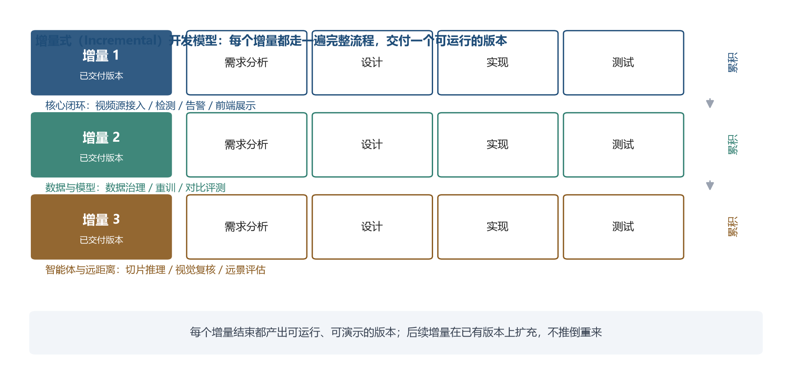

# 火情智能监测与预警系统　项目进度管理计划

> 项目：火情智能监测与预警系统（FireGuard AI）
> 小组：蔡俊杰（组长）、李汶航、欧阳宇康、陈泽恩
> 项目周期：2026-09-03 ~ 2026-11-05　｜　状态日期：2026-09-24
> 编制工具：Microsoft Project　｜　配套工程文件：`项目任务分解.mpp`
> 正文编号：一级用"一、二、三"，二级用"3.1、3.2"。

---

## 一、引言

### 1.1 编写目的

本文档用于规定火情智能监测与预警系统的进度安排，明确各任务的起止时间、里程碑、比较基准与跟踪方式，作为项目执行与进度控制的依据。

本计划适用于项目从启动到结项的完整过程。项目背景与技术方案详见《项目介绍》，本文档不再重复；产品功能与质量要求见《需求规格说明书》，任务分解见《工作任务分解说明书》，成本安排见《项目成本管理计划》。

### 1.2 背景

项目周期只有 9 周、每周投入有限，而任务包含需求、开发、数据、模型、文档五条线并行推进，任何一条线的延误都会顺着依赖关系向后传导。因此先用 Microsoft Project 建立一份可执行的进度计划与比较基准，再在执行过程中持续跟踪实际进度、识别偏差、处理资源冲突，保证项目在 2026-11-05 按期交付。

计划所用的基础信息如下：

| 项目 | 说明 |
| --- | --- |
| 项目管理软件 | Microsoft Project |
| 项目文件 | `项目任务分解.mpp`（22 项可执行任务 + 7 个摘要任务 + 5 个里程碑） |
| 项目日历 | 每周 5 个工作日；2026-10-01 ~ 10-07 国庆假期设为非工作日 |
| 资源 | 蔡俊杰、李汶航、欧阳宇康、陈泽恩（资源单位统一设为 25%，即每人每个工作日投入 2 小时） |
| 状态日期 | 2026-09-24 |
| 实际进度来源 | 小组任务台账（各任务实际起止与完成情况），与交付物完成时间相互印证 |

### 1.3 参考资料

| 类别 | 文件 |
| --- | --- |
| 项目内部 | 《项目章程》《项目介绍》《需求规格说明书》《工作任务分解说明书》《项目成本管理计划》 |
| 过程记录 | 小组任务台账、各阶段交付物完成时间、Git 提交记录 |
| 课程材料 | 课程任务说明与 Microsoft Project 操作规范 |

### 1.4 重要术语

| 术语 | 含义 |
| --- | --- |
| WBS | 工作分解结构，把项目逐层拆解为可管理的工作包 |
| 比较基准 | 计划定稿后固化下来的一组时间和成本，作为后续对比的参照 |
| 中期计划 | 执行一段时间后保存的计划快照，用于与比较基准对比 |
| 跟踪甘特图 | 同时显示比较基准与实际执行情况的甘特图 |
| PV / EV | 计划价值 / 挣值：截至某时点"应完成工作的预算"与"已完成工作的预算" |
| SPI | 进度绩效指数，SPI = EV ÷ PV，大于 1 表示进度超前 |
| 关键路径 | 决定项目最短工期的任务序列，其中任一任务延后都会导致整体延后 |

## 二、进度计划编制的背景概述

### 2.1 软件生存期模型选择与设计

编制进度计划前，先要确定采用哪种软件生存期模型，因为它直接决定阶段如何划分、任务如何排序。

**（1）候选模型对比。**

| 模型 | 特点 | 对本项目的适用性 |
| --- | --- | --- |
| 瀑布模型 | 要求严格线性的开发，每个阶段结束后经过严格的阶段性复审与确认才能进入下一阶段 | **不适用**：本项目需求在过程中仍有新增（老师中途追加了手机摄像头推流、智能体复核、远距离识别三项要求），瀑布模型处理需求变更的代价过高 |
| 增量模型 | 把软件描述、设计和实现活动分散成一系列增量，增量轮流被开发并逐个交付 | **适用**：需求可以分批纳入，每个增量都能产出可运行版本 |
| 迭代（敏捷）模型 | 以短周期迭代持续交付，强调快速响应变化 | 部分适用，但课程实训每周仅有一次固定时段，迭代节奏难以保证 |

**（2）选择增量模型的四条理由。**

1. **需求仍在演进**：老师的要求在项目启动后仍有追加，增量模型允许把新增需求放进后续增量，而不必重做已完成部分；
2. **需要尽早拿出可演示的版本**：课程实训按周推进，早期就有一个能跑通的最小系统，才能用于中期汇报与问题暴露；
3. **组员投入时间碎片化**：四人都是在校学生，无法全职投入，增量模型允许并行推进并且分批投入；
4. **各增量之间依赖清晰**：核心闭环是数据与模型、智能体与远距离两项增强的前置条件，适合按增量逐个交付。

**（3）增量模型的优点。**

早期即可见成果、风险分散到各个增量、系统可扩充、文档与产品同步产出；缺点是对架构设计的要求较高，若早期架构不稳定，后续增量可能需要返工。

**（4）适用性判断。**

本项目的复杂程度中等、整体风险中低、对文档与演示成果的依赖度高，符合增量模型适合的项目类型。**因此选择增量式作为本项目的开发模型。**

**（5）本项目的增量划分。**

| 增量 | 内容 | 对应阶段 |
| --- | --- | --- |
| 增量 1 | 核心闭环：视频源接入、烟火检测、分级预警、前端展示 | 第 1~3 周 |
| 增量 2 | 数据与模型：数据治理、模型重训与对比评测 | 第 3~5 周 |
| 增量 3 | 智能体与远距离：切片推理、视觉模型复核、远景测试集评估 | 第 5~7 周 |

### 2.2 项目团队情况简述

项目组共 4 人，均为软件工程专业同年级学生，采用一人多角色的方式分工：

| 角色 | 人员 | 能力与主要职责 |
| --- | --- | --- |
| 项目经理兼技术负责人 | 蔡俊杰 | 具备 Python 与深度学习基础，负责项目整体把控、模型训练与评测、后端检测链路、系统集成 |
| 前端与文档负责人 | 李汶航 | 具备 Vue 前端经验，负责前端页面、界面与非功能需求、项目章程 |
| 需求与质量负责人 | 欧阳宇康 | 负责需求调查与追踪、测试用例与记录、质量度量 |
| 配置与工具负责人 | 陈泽恩 | 负责配置库与版本管理、模板套用与格式统一、Project 建库 |

投入节奏：每周一次实训课（3.5 小时）为固定投入，其余为课后时间，按每人每个工作日 2 小时折算，全周期计划工作量 46.75 人天。团队无全职人员，这也是排期按"日历跨度"而不是连续工时的原因。

### 2.3 软件估算情况

| 估算项 | 结果 | 依据 |
| --- | --- | --- |
| 项目周期 | 9 周（2026-09-03 ~ 11-05），41 个工作日 | 课程实训安排 |
| 计划工作量 | 46.75 人天（374 工时） | 《工作任务分解说明书》的 WBS 与工期估算 |
| 计划成本 | 7,480 元（成本基准） | 20 元/工时（实习日薪折算）× 计划工时，详见《项目成本管理计划》 |
| 估算方法 | 自下而上（按工作包估算工期与工时）+ 类比估算 | 与前版课程项目类比，方法详见《项目成本管理计划》第二章 |

工期估算的已知局限有两条，在 3.2 的偏差分析中会得到印证：一是**依赖外部输入的任务**（等课程模板、等软件安装）按连续工时估算，实际是断续推进；二是 Project 中的**自动计划任务**，其工期会随前置任务的变化被放大，需要在保存比较基准前逐项复核。

### 2.4 软件的工作任务分解结构（WBS）

项目按生命周期划分为七个阶段，各阶段再向下拆解为工作包，完整的分解过程与工作包明细见《工作任务分解说明书》。进度计划直接采用其中的工作包作为任务：

| 阶段 | 主要内容 | 任务数 |
| --- | --- | --- |
| 1 项目启动与规划 | 立项与章程、开发环境与工具准备、项目介绍与参考资料 | 3 项 |
| 2 需求与设计 | 需求调查与建模、需求规格说明书、系统设计文档 | 3 项 |
| 3 系统开发 | 前端基础页面、后端检测闭环、前后端联调与实时画面上线 | 3 项 |
| 4 数据与模型 | 数据集获取与质量体检、首轮训练与评测、数据清洗与重划分、数据补充、重训与对比评测 | 5 项 |
| 5 智能体与远距离识别 | 切片推理与多尺度检测、智能体复核、远景测试与误报评估 | 3 项 |
| 6 测试与验收 | 功能测试与缺陷记录、缺陷修复与回归测试、误报与可靠性测试 | 3 项 |
| 7 演示与结项 | 手机推流实测与演示、结项报告与材料归档 | 2 项 |

WBS 的七个阶段与 2.1 的三个增量对应关系为：增量 1 覆盖阶段 1~3 与阶段 6 的一部分，增量 2 覆盖阶段 4，增量 3 覆盖阶段 5；阶段 6、7 在三个增量之后收口。

排期原则：前期文档与设计并行推进，中期开发与数据治理并行，后期收敛到测试与演示；投入时间固定且有限，任务之间存在硬性依赖，且受国庆假期与"演示不得使用真实火源"两条外部约束限制。

## 三、实施计划

### 3.1 进度计划

**① 表 3-1 进度计划表**

任务名称沿用《工作任务分解说明书》的工作包名称并在最前面加 WBS 编号，便于两份文档对照；工期为计划工期；开始/结束时间为本文档新增的核心内容，自 2026-09-03 起算并遵守前置依赖；资源为责任人姓名。全部任务采用**手动计划**方式固定日期。

| WBS | 任务名称 | 工期 | 开始时间 | 结束时间 | 资源 |
| --- | --- | --- | --- | --- | --- |
| 1.2 | 项目立项、章程与分工 | 2d | 2026-09-03 | 2026-09-04 | 蔡俊杰、李汶航 |
| 1.3 | 开发环境与工具准备 | 2d | 2026-09-03 | 2026-09-04 | 蔡俊杰、陈泽恩 |
| 1.4 | 项目介绍与参考资料整理 | 2d | 2026-09-07 | 2026-09-08 | 蔡俊杰、李汶航 |
| 2.1 | 需求调查与需求建模 | 3d | 2026-09-09 | 2026-09-11 | 蔡俊杰、欧阳宇康 |
| 2.2 | 需求规格说明书撰写 | 4d | 2026-09-14 | 2026-09-17 | 全员 |
| 2.3 | 系统设计文档撰写 | 5d | 2026-09-14 | 2026-09-18 | 蔡俊杰 |
| 3.1 | 前端基础页面开发 | 6d | 2026-09-07 | 2026-09-13 | 李汶航 |
| 3.2 | 后端检测闭环（视频源/检测任务/告警/接口） | 5d | 2026-09-14 | 2026-09-18 | 蔡俊杰、欧阳宇康 |
| 3.3 | 前后端联调与实时画面上线 | 3d | 2026-09-21 | 2026-09-23 | 蔡俊杰、李汶航 |
| 4.1 | 数据集获取与质量体检 | 12d | 2026-09-07 | 2026-09-22 | 陈泽恩、欧阳宇康 |
| 4.2 | 首轮模型训练与评测 | 3d | 2026-09-11 | 2026-09-15 | 蔡俊杰 |
| 4.3 | 数据清洗与防泄漏重划分 | 4d | 2026-09-11 | 2026-09-16 | 蔡俊杰、陈泽恩 |
| 4.4 | 烟雾与远距离类数据集补充 | 11d | 2026-09-17 | 2026-10-01 | 陈泽恩、李汶航、欧阳宇康 |
| 4.5 | 数据重训与现有模型对比评测 | 5d | 2026-10-02 | 2026-10-08 | 蔡俊杰 |
| 5.1 | 切片推理与多尺度检测 | 5d | 2026-10-09 | 2026-10-15 | 蔡俊杰 |
| 5.2 | 智能体复核 | 5d | 2026-10-16 | 2026-10-22 | 蔡俊杰、李汶航 |
| 5.3 | 远景测试与误报评估 | 5d | 2026-10-19 | 2026-10-23 | 陈泽恩、欧阳宇康 |
| 6.1 | 功能测试与缺陷记录 | 2d | 2026-09-24 | 2026-09-25 | 欧阳宇康 |
| 6.2 | 缺陷修复与回归测试 | 3d | 2026-09-28 | 2026-09-30 | 李汶航、蔡俊杰 |
| 6.3 | 误报与可靠性测试 | 3d | 2026-10-26 | 2026-10-28 | 陈泽恩、欧阳宇康 |
| 7.1 | 手机推流实测与演示 | 3d | 2026-10-29 | 2026-11-02 | 蔡俊杰、李汶航 |
| 7.2 | 结项报告与材料归档 | 2d | 2026-11-04 | 2026-11-05 | 全员 |

> 各项任务工期合计 95 个工作日，而项目总跨度只有 41 个工作日（2026-09-03 ~ 11-05，已扣除周末与国庆假期），差额由任务并行与多人分担实现。

**② 图 3-1 项目的活动图（网络图）**

活动图用于呈现任务之间的依赖关系与关键路径。本项目关键路径为：**需求调查 → 需求规格说明书 → 后端检测闭环 → 前后端联调 → 功能测试 → 缺陷修复 → 手机推流实测与演示**。其中需求规格说明书、系统核心闭环两个里程碑均已提前达成，说明关键路径前段执行顺利；数据治理与模型重训虽然不在关键路径上，却承担了最重的探索性工作，实际成为影响后续智能体开发的前置瓶颈（见 3.2）。

**【图 3-1】项目活动图（网络图）（截图位置）**

**③ 图 3-2 项目进度计划甘特图**

《工作任务分解说明书》的图 2-2 是仅示工期与依赖关系的工期甘特图；本文档的图 3-2 是**加入日历排期（含节假日）、带资源分配与关键任务标识**的进度甘特图，两图互补。

**【图 3-2】项目进度计划甘特图（截图位置）**

**④ 表 3-2 里程碑表**

> 《项目章程》规定的阶段里程碑见该文件；本表为可跟踪的**执行级里程碑**，具体到日期、交付物与责任人。

| 里程碑事件 | 计划日期 | 对应交付物 | 责任人 | 实际达成 | 偏差 |
| --- | --- | --- | --- | --- | --- |
| 需求规格说明书定稿 | 2026-09-18 | 《需求规格说明书》（含 UC-01~UC-16、非功能需求、附录 A） | 蔡俊杰 | 2026-09-14 | 提前 4 天 |
| 系统核心闭环完成 | 2026-09-24 | 可运行系统的实时监控、烟火检测、分级预警、告警闭环 | 蔡俊杰 | 2026-09-22 | 提前 2 天 |
| 数据治理与模型重训完成 | 2026-10-09 | 清洗后的数据集 v2 与重训模型评测报告 | 蔡俊杰 | 未开始 | 待跟进 |
| 智能体与远距离识别完成 | 2026-10-26 | 切片推理、视觉模型复核、远景测试集评估结果 | 蔡俊杰 | 未开始 | 待跟进 |
| 项目结项演示 | 2026-11-06 | 演示脚本、结项报告与全套文档 | 全员 | 未开始 | 待跟进 |

**⑤ 备注**

1. 本表安排的时间范围**已包含节假日**——国庆假期（2026-10-01 ~ 10-07）已在项目日历中设为非工作日，相关任务的工期已据此调整；
2. 任务工期表示**日历跨度**而非连续投入工时，实际投入节奏为每周一次实训课加课后时间；
3. 全部任务采用手动计划固定日期，前置关系按工作包先后顺序设置，里程碑任务工期为 0。

### 3.2 调整后的进度计划

**（1）实际与计划的偏差**

偏差 = 实际完成日期 − 计划完成日期，正值表示延后。

| ID | 任务 | 计划起止 | 实际起止 | 完成度 | 偏差 |
| --- | --- | --- | --- | --- | --- |
| 2 | 项目立项、章程与分工 | 09-03 ~ 09-04 | 09-03 ~ 09-09 | 100% | 延后 5 天 |
| 3 | 开发环境与工具准备 | 09-03 ~ 09-04 | 09-03 ~ 09-08 | 100% | 延后 4 天 |
| 4 | 项目介绍与参考资料整理 | 09-07 ~ 09-08 | 09-07 ~ 09-10 | 100% | 延后 2 天 |
| 6 | 需求调查与需求建模 | 09-09 ~ 09-11 | 09-09 ~ 09-15 | 100% | 延后 4 天 |
| 7 | 需求规格说明书撰写 | 09-14 ~ 09-17 | 09-10 ~ 09-14 | 100% | 提前 3 天 |
| 8 | 系统设计文档撰写 | 09-14 ~ 09-18 | 09-15 ~ 09-17 | 100% | 提前 1 天 |
| 10 | 前端基础页面开发 | 09-07 ~ 09-13 | 09-07 ~ 09-11 | 100% | 提前 2 天 |
| 11 | 后端检测闭环 | 09-14 ~ 09-18 | 09-14 ~ 09-18 | 100% | 按期 |
| 12 | 前后端联调与实时画面上线 | 09-21 ~ 09-23 | 09-18 ~ 09-22 | 100% | 提前 1 天 |
| 14 | 数据集获取与质量体检 | 09-07 ~ 09-22 | 09-08 ~ 09-12 | 100% | 提前 10 天 |
| 15 | 首轮模型训练与评测 | 09-11 ~ 09-15 | 09-09 ~ 09-11 | 100% | 提前 4 天 |
| 16 | 数据清洗与防泄漏重划分 | 09-11 ~ 09-16 | 未开始 | 0% | 逾期未开始 |
| 17 | 烟雾与远距离类数据集补充 | 09-17 ~ 10-01 | 09-17 ~ 进行中 | 30% | 进行中 |
| 18 | 数据重训与模型对比评测 | 10-02 ~ 10-08 | 未开始 | 0% | 未开始 |
| 20~26、28、29 | 智能体、远距离、测试与结项各任务 | 10-09 起 | 未开始 | 0% | 未开始 |

**偏差分布**：提前完成 6 项、按期 1 项、延后完成 4 项、逾期/进行中 2 项。

**【图 3-3】跟踪甘特图（实际 vs 基准）（截图位置）**

**（2）偏差原因分析**

1. **启动与文档类任务延后（4 项，+2 ~ +5 天）**：项目章程、开发环境准备、参考资料整理、需求调查都属"工作量不大但受制于外部输入"的任务——等课程模板下发、等训练环境装好、等组内评审。它们计划工期只有 2 ~ 4 天，把它当连续作业排期，实际却是断续推进，日历被拉长。
2. **技术实现类任务提前（6 项，−1 ~ −10 天）**：系统设计、前端开发、后端闭环、模型首轮训练都早于计划完成。原因是组内两名成员有 Vue 前端经验、一人有 Python 深度学习基础，实际实现速度快于按常规水平的估算。
3. **数据集任务的偏差最大（−11 天）**：它在 Project 中属于**自动计划任务**，计划工期被前置任务的完成时间连带拉长到 09-07 ~ 09-22（12 个工作日），而实际只用了 5 个工作日。这不是执行偏差，而是计划本身的估算错误。
4. **数据治理任务逾期未开始（任务 16）**：计划 09-11 ~ 09-16，截至状态日期仍未开始，是当前唯一的实质性滞后项，直接卡住后续的数据重训（任务 18）与智能体开发（任务 20~22）。

**（3）调整措施**

| 问题 | 调整措施 | 调整后 |
| --- | --- | --- |
| 数据治理逾期 | 提为最高优先级，工期由 6 天压缩为 4 天 | 任务 16 于 10 月上旬完成，不再挤压重训 |
| 等待型任务估期偏短 | 项目章程、环境准备、需求调查按"日历跨度"估期，并单独预留 1 ~ 2 天缓冲 | 后续同类任务工期上浮 1 ~ 2 天 |
| 自动计划任务虚高 | 复核全部自动计划任务工期 | 任务 14 由 12 个工作日修正为 3 个工作日 |
| 数据补充人力不足 | 任务 17 由 3 人增至 4 人 | 数据补充周期缩短 |

调整后的计划通过「项目 → 设置比较基准 → 保存中期计划」固化，形成**中期计划（比较基准 1）**。

**（4）对后续阶段的影响与追赶措施**

1. **缓冲消耗情况**：需求规格说明书与系统核心闭环分别提前 4 天、2 天达成，前段积累的缓冲被数据治理的延后消耗，目前整体 SPI 为 1.02，基本贴近计划；
2. **对里程碑的影响**：若数据清洗不能在 10 月上旬启动，"数据治理与模型重训完成"（计划 10-09）将顺延，并连带挤压智能体与远距离识别的时间；
3. **追赶措施**：一是把任务 16 的工期压缩并优先投入；二是把前期技术任务提前完成释放出的工时集中到数据补充；三是若数据治理仍来不及，按预案缩减远景测试集规模，保证演示链路完整。

**（5）基准计划与中期计划对比**

| ID | 任务 | 基准计划 | 中期计划 | 开始差 | 完成差 |
| --- | --- | --- | --- | --- | --- |
| 2 | 项目立项、章程与分工 | 09-03 ~ 09-04 | 09-03 ~ 09-09 | 0 | **+5** |
| 3 | 开发环境与工具准备 | 09-03 ~ 09-04 | 09-03 ~ 09-08 | 0 | **+4** |
| 4 | 项目介绍与参考资料整理 | 09-07 ~ 09-08 | 09-07 ~ 09-10 | 0 | **+2** |
| 6 | 需求调查与需求建模 | 09-09 ~ 09-11 | 09-09 ~ 09-15 | 0 | **+4** |
| 7 | 需求规格说明书撰写 | 09-14 ~ 09-17 | 09-10 ~ 09-14 | −4 | **−3** |
| 8 | 系统设计文档撰写 | 09-14 ~ 09-18 | 09-15 ~ 09-17 | +1 | −1 |
| 10 | 前端基础页面开发 | 09-07 ~ 09-13 | 09-07 ~ 09-11 | 0 | −2 |
| 11 | 后端检测闭环 | 09-14 ~ 09-18 | 09-14 ~ 09-18 | 0 | 0 |
| 12 | 前后端联调与实时画面上线 | 09-21 ~ 09-23 | 09-18 ~ 09-22 | −3 | −1 |
| 14 | 数据集获取与质量体检 | 09-07 ~ 09-22 | 09-08 ~ 09-12 | +1 | **−11** |
| 15 | 首轮模型训练与评测 | 09-11 ~ 09-15 | 09-09 ~ 09-11 | −2 | −4 |
| 16 以后 | 数据治理、智能体、测试与结项各任务 | 原计划 | 与基准一致 | 0 | 0 |

对比结论：中期计划把 4 项延后任务的完成日期整体后移、把 7 项提前完成的任务前移，其中变化最大的是任务 14（前移 11 天，原因是它在原计划中属于自动计划任务，工期被前置任务连带拉长）。这说明原计划对"等待外部输入"和"自动计划任务工期"两处估计不准，也直接导向了（3）的调整措施。

**【图 3-4】基准计划与中期计划对比（截图位置）**

**（6）资源冲突及解决**

在「资源工作表」中检查工作量分配，发现冲突：

| 资源 | 工作总量 | 是否超分配 |
| --- | --- | --- |
| 蔡俊杰 | 142 小时 | **是** |
| 李汶航 | 98 小时 | 否 |
| 欧阳宇康 | 84 小时 | 否 |
| 陈泽恩 | 74 小时 | 否 |

**冲突原因**：组长同时承担系统设计、后端检测闭环、模型训练与评测等技术任务，工作量约为其他成员的 1.5 倍；且原计划中系统设计文档只安排 1 人，进一步加剧了集中度。

**解决措施**：

**【图 3-5】资源工作表（各成员工作量与超分配标记）（截图位置）**

1. 系统设计文档由 1 人改为四人共同承担，按架构、界面、接口与数据、文档规范分工；
2. 后端检测闭环的接口联调部分交由李汶航承担；
3. 功能测试与缺陷记录由欧阳宇康独立负责，组长不参与；
4. 手机推流实测与演示预演由李汶航主导，组长只做最终把关。

调整后组长的工作量占比下降。需要说明的是：截至状态日期资源工作表中蔡俊杰仍带有轻微的超分配标记，因为前 3 周的技术任务确实集中由他推进，这属于已发生的事实；上述措施主要作用于 9 月下旬之后的剩余任务。

### 3.3 进度跟踪记录与进度快照

项目按周跟踪进度，共形成两次可用于对比的快照：

| 跟踪日期 | 计划价值 PV | 挣值 EV | SPI | 完成任务数 | 进行中 | 状态说明 |
| --- | --- | --- | --- | --- | --- | --- |
| 2026-09-17 | 2,040 元 | 2,880 元 | **1.41** | 9 项 | 后端检测闭环、数据集补充 | 设计文档当日完成，前端、数据集、模型首轮训练均提前完成 |
| 2026-09-24 | 3,840 元 | 3,916 元 | **1.02** | 11 项 | 数据集补充（30%） | 系统核心闭环里程碑达成，SPI 回落至接近 1 |

> 跟踪节奏：每周实训课结束后更新一次实际进度并记录快照，PV 取"截至跟踪日应完成工作的基准成本"，EV 取"已完成工作的基准成本"。**上述金额按 20 元/工时（160 元/人天）口径折算，与《项目成本管理计划》的成本基准一致**——09-24 一行的 PV、EV 与成本文档 4.2 节的挣值分析完全对应。

**【图 3-6】进度跟踪记录表与两次快照（截图位置）**

### 3.4 关于进度计划的其他说明

1. 本进度计划采用**从交付日期倒推**的方式确定各阶段时间：先定 2026-11-05 交付，再倒推智能体与远距离阶段、数据治理阶段，最后确定前期文档与开发的时间窗；
2. 阶段之间**预留了 1 ~ 2 天的机动时间**，用于吸收评审、修改与意外延误。受总周期只有 9 周的限制，不设更长的富余量；
3. 本项目的补充说明：① 每周仅有一次固定实训时段（3.5 小时），因此计划按"周"为最小管理单元；② 项目文件（`.mpp`）为二进制文件，Git 无法自动合并，约定同一时间只有一人修改；③ 实际进度以交付物完成时间与任务台账为准，不用主观估计填写。

### 3.5 关于其他计划的说明

本项目除进度计划外，还编制了配套管理计划，各计划的核心要点如下：

| 计划名称 | 核心内容 |
| --- | --- |
| 质量管理计划 | 质量目标（测试覆盖率 100%、用例通过率 ≥95%、mAP50 ≥0.70）与评审、审计、缺陷处理流程 |
| 成本管理计划 | 按 20 元/工时（实习日薪折算）折算人力成本，总预算 7,480 元，并用挣值管理跟踪 |
| 配置管理计划 | 以 Git 作为配置库，管理配置项、三条基线与变更流程，保证完整性与可追溯性 |
| 风险管理计划 | 按开发阶段识别、评估与应对风险，重点关注数据质量与技术选型 |
| 沟通管理计划 | 明确信息沟通要求、沟通方式与时间，保证正确的人在正确的时候得到正确的信息 |
| 人力资源管理计划 | 团队组织、人员获取与配置、团队建设与培训、绩效与考核 |

各计划的详细内容见对应的实验文档。

## 四、项目成果产品

本计划的直接产物：① 配置完成进度计划的项目管理软件工程文件 `项目任务分解.mpp`；② 进度跟踪记录表与两次进度快照（见 3.3）；③ 基准计划与中期计划对比分析资料（见 3.2（5））；④ 任务优化及资源冲突解决方案（见 3.2（3）（6））。

项目本身交付的产品如下。

### 4.1 软件程序

| 项目 | 内容 |
| --- | --- |
| 程序名称 | 火情智能监测与预警系统（FireGuard AI） |
| 所用的编程语言 | Python（后端与模型）、JavaScript（前端）、SQL（数据）、HTML/CSS（页面）；详见《项目介绍》2.2 |
| 存储程序的媒体形式 | 项目 Git 仓库（源码）＋ 本机部署包（含模型权重） |
| 交付物说明 | 系统能够完成"视频源接入 → 实时烟火检测 → 分级预警 → 前端展示 → 历史与统计"的完整闭环；支持手机摄像头推流、本地上传视频与 RTSP 三类视频源 |

### 4.2 软件文档

| 文档 | 作用 |
| --- | --- |
| 项目章程 | 确立项目目标、时间边界与团队分工 |
| 项目介绍 | 统一项目背景、技术方案与人员分工认知 |
| 需求规格说明书 | 规定业务范围、功能需求与非功能需求，作为需求基线 |
| 工作任务分解说明书 | 给出 WBS 与工作包清单 |
| 进度管理计划（本文档） | 规定进度安排、比较基准与跟踪方式 |
| 成本 / 质量 / 配置 / 风险 / 沟通 / 人力资源管理计划 | 对应各管理领域的安排与措施 |
| 验收报告 | 记录验收过程与结论 |
| 用户使用手册 | 指导用户如何使用系统 |

> 上述文档中属于配置项的，必须在《配置管理计划》的配置项清单中出现同名条目，两份文档要对齐。

### 4.3 软件服务

交付后的服务安排：**课堂演示支持**（准备演示脚本与应急预案，保证现场演示可控可复现）、**部署指导**（提供环境安装与启动步骤）、**维护安排**（结项后由组长负责答疑与缺陷修复）。

### 4.4 非移交的软件产品

以下为本项目内部产物，不随产品移交：项目计划、质量保证计划、编码规则、测试计划、测试用例、测试报告、配置管理计划、需求规格说明书、概要设计说明书、详细设计说明书、设计术语及规范、源程序、**数据集与模型权重**。

> 《需求规格说明书》5.5 已规定"数据集与模型权重不进入代码仓库"，因此这两项明确列为非移交项。

### 4.5 验收标准

- **验收对象与总体要求**：验收对象包括程序、数据和文档三部分；以《需求规格说明书》确定的功能与质量要求为验收依据。
- **验收依据**：功能与质量验收标准详见《需求规格说明书》3.7 测试与验收规范、5.3 产品质量需求，以及 UC-01 ~ UC-16 各用例的验收标准行。
- **验收测试类型**：安装测试、功能测试、界面测试、性能测试、文档测试；各类型的具体规范见上述依据文件，此处不展开。
- **本计划负责的部分**：验收的时间安排（2026-11-04 ~ 11-05 结项归档期间）、参与人员（全员）、组织方式（现场演示 + 文档检查）、通过准则（**用例通过率 ≥ 95%、严重缺陷清零**，该指标取自《工作任务分解说明书》的验收标准）。

## 五、其他 / 保障措施

1. **计划逐步完善**：首版计划在项目启动周编制，随着实际执行情况在每周跟踪时修订，修订结果反映在中期计划中；
2. **组织保障**：每周实训课固定用于进度对齐与问题处理，任务卡按人发布，卡住的问题当场解决；
3. **技术保障**：项目文件与全部文档纳入 Git 版本管理，任何时候都能回溯到某一版计划；
4. **数据保障**：实际进度以交付物时间与任务台账为准，不用"感觉"填进度。

---

## 附件：图片准备清单（共 6 张，全部在项目文件 项目任务分解.mpp 中出图）

正文里已按出现顺序放好占位框，插入图片后把占位框删掉即可。

| 图号 | 图名 | 放在哪一节 | 在 Project 里怎么出图 |
| --- | --- | --- | --- |
| 图 3-1 | 项目活动图（网络图） | 3.1 | 视图 → **网络图**；任务框设置为显示"名称 / 工期 / 开始 / 完成"；手动拖动节点减少连线交叉，让关键路径尽量从左到右排成一条线；整图截图 |
| 图 3-2 | 项目进度计划甘特图 | 3.1 | 视图 → **甘特图**；左侧任务表显示 WBS、任务名称、工期、开始时间、完成时间、前置任务、资源名称；时间轴按"周"缩放；格式 → 勾选**关键任务**（关键路径显示为红色） |
| 图 3-3 | 跟踪甘特图（实际 vs 基准） | 3.2（1） | 视图 → 其他视图 → **跟踪甘特图**；每项任务会同时显示基准条与当前条，已录实际进度的任务上面还有一条实际条 |
| 图 3-4 | 基准计划与中期计划对比 | 3.2（5） | 在任务表视图中插入 **"完成时间 1"** 列（即保存的中期计划完成日期），与 **"比较基准完成时间"** 列并列显示；截任务表即可 |
| 图 3-5 | 资源工作表 | 3.2（6） | 视图 → **资源工作表**；显示"最大单位 / 工时 / 过度分配"三列，超分配的资源会显示为红色 |
| 图 3-6 | 进度跟踪记录表与两次快照 | 3.3 | 3.3 的表格可另存为 Excel 后截图；"快照"即两次跟踪时点的任务完成状态截图，与表一起放 |
